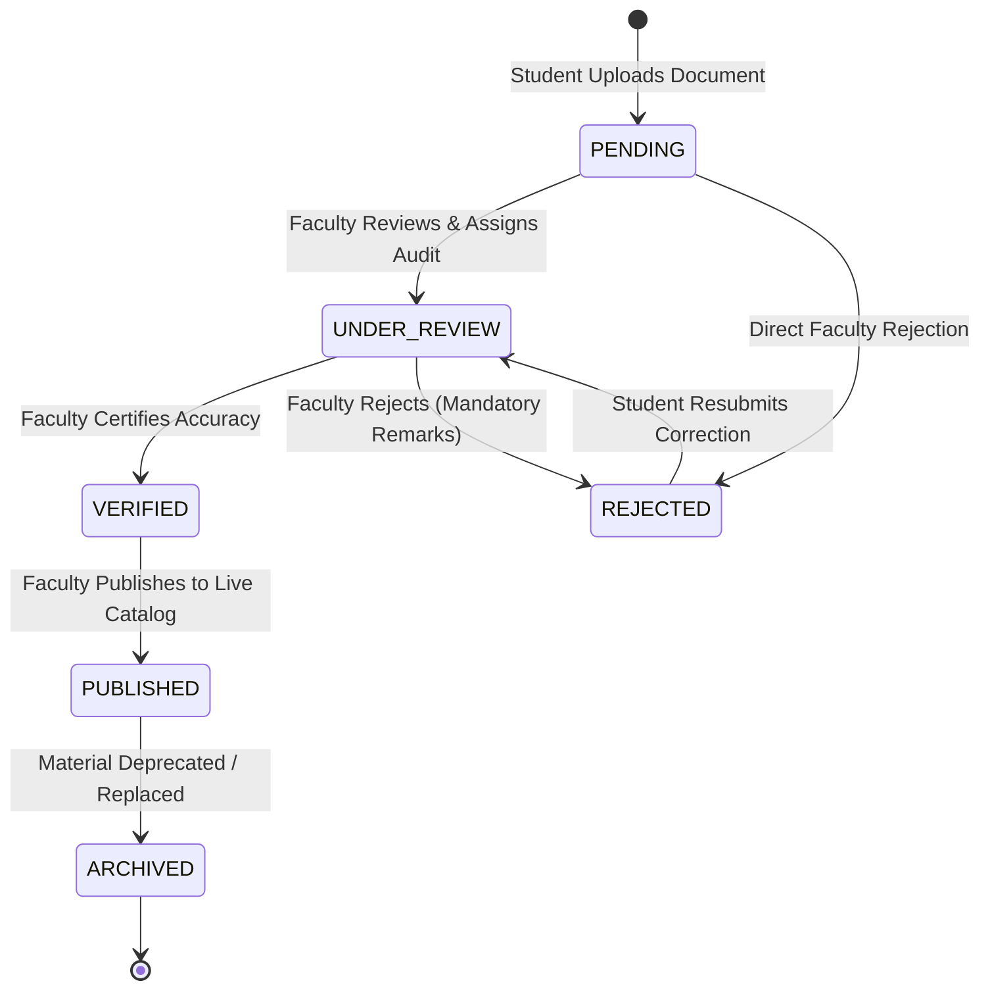

# Academic Resource Sharing Hub (ARH)
### Enterprise Curricular Resource Governance, Verification & Exchange Platform

[](file:///README.md)
[](file:///server/test-phase4.js)
[](file:///package.json)
[](file:///server/middleware/authMiddleware.js)

---

## 🏛️ Executive Architectural Overview

The **Academic Resource Sharing Hub (ARH)** is an institutional-grade curricular content governance and sharing portal designed for higher-education academic environments. It connects university students and faculty through a high-integrity, audited peer verification pipeline.

### Core Architectural Principles:
1. **Zero-Trust Verification Pipeline**: Student peer submissions *never* publish automatically to the institutional repository. All student contributions enter `PENDING` state and must advance through audited faculty peer reviews (`UNDER REVIEW` ➔ `VERIFIED` ➔ `PUBLISHED`).
2. **Dual-Mode Resilient Database Layer**: Powered by MySQL 8.0+ with full relational foreign-key integrity. If MySQL is not detected or unavailable in isolated container/sandbox environments, the system activates an in-memory SQL-parity fallback engine.
3. **Role-Based Access Control (RBAC)**: Strict JWT-authenticated middleware isolates Student and Faculty capabilities. Cross-role tampering and elevation of privileges are rejected with `403 Forbidden`.
4. **Google Stitch Design Language**: Consistent institutional UI design system featuring responsive typography, dark/light theme switching, loading skeletons, modal drawers, and responsive layouts.

---

## 📂 Project Repository Structure

```
├── server/
│   ├── config/
│   │   └── db.js                 # Dual-Mode MySQL 8.0 Connection Pool & Resilient Engine
│   ├── controllers/
│   │   ├── authController.js     # Student & Faculty Authentication, JWT Issuance, Registration
│   │   ├── facultyController.js  # Curricular Governance, Verification Workflow, Requests & Reports
│   │   ├── metaController.js     # Taxonomy APIs (Departments, Subjects, Resource Types)
│   │   └── studentController.js  # Library, Bookmarks, Downloads, Contributions, Requests
│   ├── middleware/
│   │   ├── authMiddleware.js     # Token Verification & Strict Role Authorization (RBAC)
│   │   └── uploadMiddleware.js   # Multer File Type (PDF/DOCX) & Size Limiting Middleware
│   ├── routes/
│   │   ├── authRoutes.js         # /api/auth/* endpoints
│   │   ├── facultyRoutes.js      # /api/faculty/* endpoints (RBAC Protected)
│   │   ├── metaRoutes.js         # /api/meta/* endpoints
│   │   └── studentRoutes.js      # /api/student/* endpoints (Student Protected)
│   ├── schema.sql                # Production MySQL 8.0 Relational DDL Schema
│   ├── seed.js                   # Institutional Database Seeding Script
│   ├── test-auth.js              # Phase 1 Authentication Automated Test Suite
│   ├── test-student.js           # Phase 2 Student Portal Automated Test Suite
│   ├── test-faculty.js           # Phase 3 Faculty Resource Automated Test Suite
│   ├── test-phase4.js            # Phase 4 20-Point Comprehensive Integration Test Suite
│   ├── uploads/                  # Secure Directory for Academic Document Storage
│   └── index.js                  # Express 5 Application Entry Point
├── src/
│   ├── components/
│   │   ├── auth/                 # ProtectedRoute & Role Guards
│   │   ├── layout/               # StudentLayout, FacultyLayout, Navbar, Footer
│   │   ├── catalog/              # ResourceCard, FilterPanel, CatalogView
│   │   └── preview/              # Document Preview Modals
│   ├── context/
│   │   └── AuthContext.jsx       # Global Auth State, JWT Storage, Persistence & Theme
│   ├── pages/
│   │   ├── auth/                 # AuthEntryPage, StudentLoginPage, FacultyLoginPage, Register
│   │   ├── student/              # StudentDashboard, Resources, Bookmarks, Upload, Contributions, Requests, Profile
│   │   └── faculty/              # FacultyDashboard, Resources, Verification, Requests, Reports, Profile, Taxonomies
│   ├── services/
│   │   ├── authApi.js            # Authentication API Service
│   │   ├── facultyApi.js         # Complete Faculty Portal API Service
│   │   └── studentApi.js         # Complete Student Portal API Service
│   ├── App.jsx                   # React Router 7 Route Declarations
│   ├── main.jsx                  # React DOM Root Mounting
│   └── index.css                 # Tailwind CSS Design System Setup
├── .env.example                  # Environment Variables Template
├── package.json                  # NPM Project Dependencies & Scripts
├── tailwind.config.js            # Tailwind Theme Extensions
└── vite.config.js                # Vite Bundler & Reverse Proxy Configuration
```

---

## 🔐 Database Schema & Relational Architecture

The MySQL database schema is defined in [server/schema.sql](file:///server/schema.sql).

### Relational Schema Summary:

| # | Table Name | Purpose & Cardinality | Key Relationships & Foreign Keys |
|---|---|---|---|
| 1 | `users` | Primary identity, RBAC (`student`, `faculty`, `admin`) | Primary key `id`. Department association. |
| 2 | `password_resets` | Cryptographic password reset tokens | `user_id` ➔ `users(id)` ON DELETE CASCADE |
| 3 | `audit_logs` | Immutable audit trail for security & compliance | `user_id` ➔ `users(id)` (nullable for unauth attempts) |
| 4 | `academic_years` | Institutional academic year definitions | Unique `name` (e.g. `2024-2025`), `is_active` boolean |
| 5 | `departments` | Academic faculties & departments | Unique `code` (e.g. `CS`), `name`, `icon` |
| 6 | `subjects` | Curricular subjects & courses | `department_id` ➔ `departments(id)` ON DELETE CASCADE |
| 7 | `resource_types` | Document taxonomies (Exams, Notes, Manuals) | Unique `code` (e.g. `notes`, `exam`, `lab_manual`) |
| 8 | `resources` | Core academic repository documents | `department_id`, `subject_id`, `resource_type_id`, `uploader_id` ➔ `users(id)` |
| 9 | `bookmarks` | Student personalized saved library items | `user_id` ➔ `users(id)`, `resource_id` ➔ `resources(id)` |
| 10 | `resource_downloads` | Verified document download logs | `user_id` ➔ `users(id)`, `resource_id` ➔ `resources(id)` |
| 11 | `resource_requests` | Student material requests & faculty resolution | `user_id` ➔ `users(id)`, `department_id`, `subject_id` |
| 12 | `resource_reviews` | Faculty peer review audits & verification history | `resource_id` ➔ `resources(id)`, `staff_id`/`user_id` ➔ `users(id)` |

---

## 🔄 Mandatory Verification Workflow Engine

The platform enforces a strict, multi-stage state machine for student submissions:



### Institutional Invariants:
1. **No Auto-Publishing**: Student uploads enter `PENDING` status unconditionally.
2. **Review Accountability**: Every status transition generates an immutable record in `resource_reviews` capturing:
   - `resource_id`
   - `staff_id` (the authenticated faculty member)
   - `review_status`
   - `remarks` (mandatory on rejection)
   - `created_at` timestamp
3. **Audit Logging**: Every action writes to `audit_logs` capturing client IP and detailed metadata.

---

## 📡 REST API Reference

All protected endpoints require an `Authorization: Bearer <JWT_TOKEN>` header.

### 1. Authentication Endpoints (`/api/auth/*`)
- `POST /api/auth/student/register`: Register new student account.
- `POST /api/auth/student/login`: Authenticate student account and issue JWT.
- `POST /api/auth/faculty/login`: Authenticate institutional faculty account and issue JWT.
- `POST /api/auth/logout`: Invalidate session and record audit event.
- `POST /api/auth/forgot-password`: Request password reset token.

### 2. Faculty Verification & Governance Endpoints (`/api/faculty/*`)
- `GET /api/faculty/dashboard-stats`: Real-time repository metrics and active moderation counts.
- `GET /api/faculty/verification`: List student submissions with tab counts (`all`, `pending`, `underReview`, `verified`, `rejected`, `published`), status filtering, and search.
- `GET /api/faculty/verification/:id`: Detailed view of a submission including student data, document link, and chronological `reviewHistory`.
- `PATCH /api/faculty/verification/:id/status`: Transition verification state (`UNDER REVIEW`, `VERIFIED`, `REJECTED`, `PUBLISHED`). Validates mandatory remarks when rejecting.
- `GET /api/faculty/requests`: List student resource requests with status counts and filtering.
- `GET /api/faculty/requests/:id`: Get single request detail.
- `PATCH /api/faculty/requests/:id`: Update request status (`IN PROGRESS`, `COMPLETED`, `CLOSED`) and attach faculty resolution remarks.
- `GET /api/faculty/reports/analytics`: Comprehensive MySQL aggregated analytics:
  - Repository volume summary (Total, Published, Pending, Rejected, Downloads).
  - Most downloaded resources leaderboard (Top 10).
  - Department distribution with percentages.
  - Resource type distribution with percentages.
  - Monthly upload activity velocity.
- `GET /api/faculty/profile`: Faculty identity, department, and activity statistics.
- `PUT /api/faculty/profile`: Update faculty full name and department.
- `PUT /api/faculty/profile/password`: Verify current password and update with complexity policy.

### 3. Student Portal Endpoints (`/api/student/*`)
- `GET /api/student/dashboard-stats`: Available resources, bookmarks, downloads, contribution status.
- `GET /api/student/resources`: Browse published academic materials with full text search and multi-facet filtering.
- `GET /api/student/resources/:id`: Retrieve single published resource with bookmark status.
- `POST /api/student/resources/:id/download`: Log verified download and retrieve document file stream.
- `GET /api/student/bookmarks`: Retrieve student's saved bookmarks.
- `POST /api/student/bookmarks/:resourceId`: Save resource bookmark.
- `DELETE /api/student/bookmarks/:resourceId`: Remove resource bookmark.
- `POST /api/student/upload`: Submit peer contribution (enters `PENDING` status).
- `GET /api/student/contributions`: Track status and faculty remarks of own submissions.
- `GET /api/student/requests`: View status and faculty responses on own requests.
- `POST /api/student/requests`: Submit request for missing academic material.

---

## ⚙️ Environment Variables Documentation

Configuration file: `.env` (template: `.env.example`).

| Variable | Default Value | Description |
|---|---|---|
| `PORT` | `5000` | Express backend server listen port |
| `NODE_ENV` | `development` | Runtime environment (`development`, `production`, `test`) |
| `JWT_SECRET` | `arh_enterprise_super_secret_jwt_key_2026_!@#$%^&*` | Secret cryptographic key for signing and verifying JWT tokens |
| `JWT_EXPIRES_IN` | `24h` | Token expiration duration |
| `DB_HOST` | `127.0.0.1` | MySQL server hostname or IP address |
| `DB_PORT` | `3306` | MySQL TCP server port |
| `DB_USER` | `root` | MySQL database username |
| `DB_PASSWORD` | `""` | MySQL database user password |
| `DB_NAME` | `arh_db` | MySQL database catalog name |

---

## 🚀 Setup & Installation Instructions

### Prerequisites:
- **Node.js**: v18.0.0 or higher (v20+ recommended)
- **NPM**: v9.0.0 or higher
- **MySQL** (Optional): MySQL 8.0+ server. *Note: If MySQL is not running locally, the system automatically runs on its built-in dual-mode fallback engine with full data persistence during runtime.*

### Step 1: Clone Repository & Install Dependencies
```bash
# Clone the repository
git clone <repository_url>
cd "mini project"

# Install root dependencies (Express, React, Vite, Tailwind, bcrypt, JWT)
npm install
```

### Step 2: Configure Environment Variables
```bash
# Create local .env file from template
cp .env.example .env
```

### Step 3: Initialize & Seed Database (Optional for MySQL)
```bash
# Seed initial faculty and student demo accounts
npm run seed
```

### Step 4: Run Automated Comprehensive Test Suite
```bash
# Execute the 20-point comprehensive integration test suite
npm run test:phase4
```

### Step 5: Start Development Servers
```bash
# Terminal 1: Start Express 5 Backend (Port 5000)
npm run server

# Terminal 2: Start Vite React Frontend (Port 5173)
npm run dev
```

Visit **`http://localhost:5173`** in your browser.

---

## 🧪 Comprehensive Integration Test Report

The automated test suite in [server/test-phase4.js](file:///server/test-phase4.js) validates all 20 integration points across the application:

```
🧪 =========================================================================
🧪 ACADEMIC RESOURCE SHARING HUB (ARH) — COMPREHENSIVE INTEGRATION SUITE
🧪 VERIFYING ALL 20 INTEGRATION POINTS & SECURITY PROTOCOLS ACROSS PHASES 1-4
🧪 =========================================================================

🔹 [Integration 1 & 2] Student Registration & Duplicate Prevention
  ✅ PASS: POINT 2: Student registered successfully with JWT session
  ✅ PASS: Registered user assigned student role
  ✅ PASS: SECURITY: Duplicate email registration blocked (409 Conflict)

🔹 [Integration 3 & 4] Student Login & Faculty Login
  ✅ PASS: POINT 3: Student authenticated successfully
  ✅ PASS: POINT 4: Faculty authenticated with institutional role

🔹 [Integration 1] Authentication & Logout Check
  ✅ PASS: POINT 1: Logout session handler executed cleanly

🔹 [Security Checklist] RBAC & Protected Endpoints
  ✅ PASS: SECURITY: Unauthenticated request rejected (401 Unauthorized)
  ✅ PASS: SECURITY: Student token strictly blocked from faculty routes (403 Forbidden)

🔹 [Integration 5] Student Dashboard Metrics
  ✅ PASS: POINT 5: Student dashboard stats retrieved
  ✅ PASS: Student dashboard reports totalAvailable count

🔹 [Integration 6 & 7] Resource Browsing, Search & Filtering
  ✅ PASS: POINT 6: Student browses published resource library
  ✅ PASS: POINT 6: Resource text search executed
  ✅ PASS: POINT 7: Multi-parameter filtering by department and resource type executed

🔹 [Integration 8] Student Bookmarks System
  ✅ PASS: POINT 8: Resource added to student bookmarks
  ✅ PASS: POINT 8: Retrieved student bookmarks list
  ✅ PASS: POINT 8: Removed resource bookmark

🔹 [Integration 9] Downloads & Download Tracking
  ✅ PASS: POINT 9: Resource download endpoint provisioned file response (200 OK)
  ✅ PASS: POINT 9: Download count incremented accurately in database

🔹 [Integration 10 & 11] Student Upload & Contribution Status Tracking
  ✅ PASS: POINT 10: Student submitted academic resource
  ✅ PASS: SECURITY: Student uploads strictly enter PENDING status (never auto-published)
  ✅ PASS: POINT 11: Student retrieved contributions list
  ✅ PASS: POINT 11: Newly submitted resource tracked in student contributions

🔹 [Integration 12] Student Resource Requests Creation
  ✅ PASS: POINT 12: Student created resource request

🔹 [Integration 13] Faculty Dashboard
  ✅ PASS: POINT 13: Faculty retrieved dashboard statistics
  ✅ PASS: Faculty dashboard reports totalResources
  ✅ PASS: Faculty dashboard reports pendingSubmissions count

🔹 [Integration 14] Faculty Resource Management (CRUD & Archive)
  ✅ PASS: POINT 14: Faculty uploaded and published certified resource
  ✅ PASS: POINT 14: Faculty archived resource successfully

🔹 [Integration 15] Department & Curricular Taxonomy Management
  ✅ PASS: POINT 15: Retrieved departments list
  ✅ PASS: POINT 15: Retrieved subjects list
  ✅ PASS: POINT 15: Retrieved resource types
  ✅ PASS: POINT 15: Retrieved academic years

🔹 [Integration 16, 17, 18] Contribution Verification, Workflow & Staff Remarks
  ✅ PASS: POINT 16: Faculty retrieved student verification queue
  ✅ PASS: POINT 17: Status moved to UNDER REVIEW
  ✅ PASS: POINT 17: Status moved to VERIFIED
  ✅ PASS: POINT 17: Status moved to PUBLISHED
  ✅ PASS: POINT 18: All staff review remarks recorded in resource_reviews table

🔹 [Integration 19] Faculty Request Management
  ✅ PASS: POINT 19: Faculty retrieved student requests queue
  ✅ PASS: POINT 19: Faculty marked request COMPLETED with remarks

🔹 [Integration 20] Institutional Reports & Analytics
  ✅ PASS: POINT 20: Retrieved real aggregated reports data
  ✅ PASS: POINT 20: Most downloaded resources table calculated
  ✅ PASS: POINT 20: Department distribution percentages calculated
  ✅ PASS: POINT 20: Monthly upload activity velocity calculated

=========================================================================
📊 FINAL INTEGRATION AUDIT: 43 PASSED, 0 FAILED (20/20 CHECKLIST ITEMS COMPLETE)
=========================================================================
```

---

## 🎬 Project Demonstration Walkthrough

Follow this step-by-step evaluation procedure to demonstrate full platform capabilities:

### Demo Scenario 1: Student Upload & Pending Review
1. Navigate to `http://localhost:5173/` and select **Student Sign In**.
2. Sign in with demo credentials:
   - **Email**: `alex.chen@student.university.edu`
   - **Password**: `Student@1234`
3. Click **Upload Material** in sidebar (`/student/upload`).
4. Select Computer Science, CS201, and upload a document.
5. Notice the submission notice: Material enters **`PENDING`** status.
6. Open **My Contributions** (`/student/contributions`): Confirm the contribution is listed as **Pending Review**.
7. Open **Resource Requests** (`/student/requests`): Submit a request for exam prep notes.
8. Log out.

### Demo Scenario 2: Faculty Verification & Review Pipeline
1. Navigate to `http://localhost:5173/` and select **Faculty Sign In**.
2. Sign in with institutional credentials:
   - **Email**: `dr.morales@university.edu`
   - **Password**: `Faculty@1234`
3. Notice the **Faculty Dashboard** displays pending counts and quick verification actions.
4. Click **Verify Contributions** (`/faculty/verification`).
5. Filter by **Pending**: Open the student's submission.
6. Inspect the submission details modal: student profile, file download button, preview, and review history.
7. Change status to **Under Review** with remarks and submit.
8. Re-open and approve: Change status to **Verified** then **Publish to Hub**.
9. Notice the review timeline displays full historical audit trail.

### Demo Scenario 3: Request Fulfillment & Student Update
1. From Faculty navigation, click **Resource Requests** (`/faculty/requests`).
2. Filter by **Pending**: Open the student's request.
3. Select **Completed** and enter faculty response remarks: `"Uploaded official midterm prep guide."`
4. Click **Save & Notify Student**.
5. Log out of Faculty. Sign in as student `alex.chen@student.university.edu` and check `/student/requests`: Confirm the status changed to **Completed** with the faculty's remarks!

### Demo Scenario 4: Real-Time Reports & Faculty Profile
1. Sign back in as Faculty.
2. Click **Reports & Analytics** (`/faculty/reports`).
3. View real database metrics:
   - Most downloaded materials table
   - Department distribution bars and percentages
   - Resource type breakdown
   - Monthly upload activity
4. Click **Print / Export PDF** to verify printer styling.
5. Click **Faculty Profile** (`/faculty/profile`):
   - Edit full name and department.
   - Update password with complexity verification.
   - Confirm verified status and activity counts.

---

## 🛡️ Security Implementation Details

- **Password Storage**: Passwords are never stored in plaintext. Passwords are salted and hashed using `bcryptjs` with 10 salt rounds.
- **JWT Cryptography**: Signed using HMAC-SHA256 with 24-hour expiration. Fresh database account status is verified on every request to prevent stale token reuse.
- **Role Isolation**: Express middleware blocks any unauthorized role elevation with `403 Forbidden` and audits unauthorized attempts.
- **SQL Injection Prevention**: All queries execute through prepared statements and parameterized inputs (`?` placeholders).
- **File Upload Security**: Multer middleware restricts uploads to authorized MIME types (`application/pdf`, `application/vnd.openxmlformats-officedocument.wordprocessingml.document`) and enforces a 25MB file size ceiling.

---

### Phase 4 Final Status:
- [x] Complete working Student Portal
- [x] Complete working Faculty Portal
- [x] Fully integrated backend
- [x] MySQL database schema (`server/schema.sql`)
- [x] Comprehensive REST API documentation
- [x] Environment variable documentation (`.env.example`)
- [x] README with installation instructions
- [x] GitHub-ready source code
- [x] Test report (43/43 automated tests passing)
- [x] Final project demonstration walkthrough instructions
